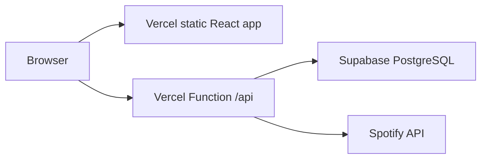

# Hosting and performance check — 18 October 2026

The frontend and API are now live together at [dssconfessions.vercel.app](https://dssconfessions.vercel.app/). Supabase is `ACTIVE_HEALTHY`, with all 56 existing confessions preserved. Shared rate limits and feed/search indexes have been applied. Public browser checks confirm that every application API request goes to Vercel; Render is no longer an application dependency.

## Completed Vercel deployment

- **Deployment:** `dpl_YkXPxKvdQHZDXVT5izK5oBNFLSQb`, target `production`, status `READY`.
- **Build URL:** [dssconfessions-hu1p2xiix-snowis-projects.vercel.app](https://dssconfessions-hu1p2xiix-snowis-projects.vercel.app/). This deployment URL retains Vercel Authentication; the public production domain is accessible normally.
- **Configuration:** existing `snowis-projects/dssconfessions` project, repository root, Node.js 24.x, Vite build, static output `client/dist`, Functions in Sydney (`syd1`). Access was resolved through an authenticated Vercel CLI session.
- **Environment:** configured Supabase and Spotify server variables for production and preview; removed the old `VITE_API_BASE_URL`. Secret values were supplied over stdin and were not printed or committed.
- **Release:** deployed a production build without moving the main domain, tested the protected build with authenticated requests, then promoted that exact build. No rebuild occurred during promotion.
- **Public checks:** HTTP 200 for the site, dependency health, feed and song search. One sample measured 332 ms for health, 481 ms for the feed and 772 ms for Spotify search. A subsequent feed request returned a CDN `HIT` in 61 ms. These are individual samples, not percentiles.
- **Browser:** production rendered 20 real stories, handled recipient search and displayed five live Spotify results, with no uncaught browser errors. All application API hosts were `dssconfessions.vercel.app`; the compiled frontend contains no Render endpoint.
- **Validation:** unknown API paths return JSON 404, invalid submissions return HTTP 400, and the final deployment's runtime error-log query returned no error entries.
- **Source:** deployed from the local working tree. Changes remain uncommitted/unpushed; commit the source and lockfiles before a future Git-triggered deployment. The previous Render service was retained for rollback and was not deleted.

The build's dependency audit revealed known vulnerabilities in the original lockfiles. Compatible dependency updates now produce **zero vulnerabilities** for both applications, confirmed by fresh installs and the final remote build. The backend uses Axios 1.20.0 and patched proxy/address/query dependencies; development watching now uses Node's built-in `--watch` instead of nodemon. The client uses patched Axios, Vite, CSS and build dependencies. Fresh-install lint, build, all 14 tests and the browser submission/retry fixture flow passed. Loading states were moved into event handlers and asynchronous request callbacks to satisfy the updated React lint checks.

## Initial production state, before database recovery

Checks were made around 15:38–15:50 Asia/Manila. These are individual requests, not load tests or percentile measurements.

| Component | Evidence |
| --- | --- |
| Frontend | `https://dssconfessions.vercel.app/` returned HTTP 200, about 619 ms for one Node HTTP request. |
| Render API | `https://dssconfessions.onrender.com/` initially exceeded a 20-second timeout; a later warm request returned HTTP 200 in 436 ms. The registered service is not suspended and its latest deploy is marked live. |
| Spotify search | The existing Render endpoint returned HTTP 200 in 706 ms once warm. |
| Confession feed | The Render endpoint returned HTTP 500, `Fetch failed`, after about 9.4 seconds. |
| Incorrect local URL | `https://dssconfessions-api.onrender.com/` returned HTTP 404. The deployed frontend bundle uses the correct Render hostname; the incorrect value was in the local frontend environment file. |
| Supabase | `dssconfessions` (`zmblwehfnnsozjhbrlwr`) is `INACTIVE`; its REST hostname returned DNS NXDOMAIN. Region: Sydney (`ap-southeast-2`). |
| Other visible project | `lsms` is `ACTIVE_HEALTHY`. No configuration or data changes were made to it. |
| Account visibility | One organization, `DSSConfessions`, on the Free plan; only the two projects above are visible to the connector. |
| Resume attempt | Supabase refused to resume `dssconfessions`, reporting that `jsnowify` has reached the two-active-free-project limit. The second counted active project cannot be identified from this connector's visible inventory. |
| Render metrics | CPU, memory, latency and request-count queries returned empty series. No production utilization or p95 conclusions can be drawn. |
| Vercel access | Project discovery succeeded, but reading its settings returned HTTP 403 for scope `snowis-projects`. CLI fallback had no saved credentials. No deployment was made. |

Supabase's quota includes projects across organizations where a member is Owner or Administrator; paused projects do not count. Check all organizations in the dashboard, and confirm that the dashboard and connector use the same account. Do not pause `lsms`. See the [billing FAQ](https://supabase.com/docs/guides/platform/billing-faq).

## Database recovery and live verification

The project was restored on 18 October and became `ACTIVE_HEALTHY`. Its schema, privileges and row count were inspected before applying changes. Only the dssconfessions project was modified; no changes were made to `lsms`.

- Applied migrations: `20261018080243_serverless_rate_limits` and `20261018080247_confession_indexes`. Local filenames match Supabase's recorded migration history.
- Added a descending `created_at` index for the feed and a `pg_trgm` GIN index for substring recipient searches. The existing btree recipient index was retained. See [PostgreSQL trigram index support](https://www.postgresql.org/docs/current/pgtrgm.html#PGTRGM-INDEX).
- Live SQL confirms RLS is enabled, `anon` and `authenticated` cannot read the confession table or execute the limiter RPC, and `service_role` can execute it. The limiter uses `SECURITY INVOKER`.
- A live concurrent RPC test sent 12 requests with a quota of five: five were allowed and seven denied. The synthetic test counter was removed afterward. Existing confession count remained 56.
- The new API, running locally with the Vercel rate-limit mode and real dependencies, returned HTTP 200 for health (693 ms), the latest 20 stories (791 ms), a recipient search with zero matches (569 ms), and five Spotify results (955 ms). An invalid submission returned HTTP 400. No live confession was created.
- Chrome also verified the full read flow through the Vite proxy and new Express API: rendering 20 real confessions, searching recipients and displaying five live Spotify results. There were no uncaught browser errors.
- The existing Render service also recovered: one sample returned HTTP 200 for its root (303 ms), feed (568 ms), and song search (693 ms). These single-request measurements are not percentile or load-test results.
- A recipient-search `EXPLAIN ANALYZE` completed in 0.216 ms for 56 rows. PostgreSQL chose a sequential scan at this small table size; the new indexes provide supported access paths as data grows. Recovery, rather than an index speedup, explains the change from failed requests to working requests.
- Advisors reported no errors or warnings. Informational notices remain for [RLS without policies](https://supabase.com/docs/guides/database/database-linter?lint=0008_rls_enabled_no_policy) on the deliberately private, service-only limiter table and [unused indexes](https://supabase.com/docs/guides/database/database-linter?lint=0005_unused_index). Those notices do not grant browser access or justify deleting newly created indexes.

## Live architecture

The existing Express app is exported from `server/app.js`; `api/index.js` exposes it as a Vercel Function. `server/index.js` remains the local listener. This follows the supported [Express export pattern](https://vercel.com/docs/frameworks/backend/express).

- The frontend defaults to same-origin `/api`; Vite proxies it to `localhost:5000` during development.
- Vercel API routing precedes the SPA fallback. Unknown API routes remain JSON 404s.
- Functions are placed in `syd1`, near the existing database. Update this if the database moves.
- Supabase and Spotify credentials stay on the server. Frontend variables must never contain the service role or Spotify secret.
- The public feed has a 15-second shared-cache lifetime; song searches have 60 seconds. Recipient searches, writes, health checks and errors are not cached. A new post can take up to 15 seconds to appear through the CDN.
- Supabase calls have eight-second timeouts. Spotify calls also have eight-second timeouts. The browser request timeout is 35 seconds and the Vercel Function limit is 45 seconds.
- Concurrent Spotify token requests share one in-flight refresh per warm instance.
- Feed failures show a retry action instead of looking like an empty database. Stale song requests are cancelled and selecting a song does not launch another search.
- The server now accepts the form's existing 3,000-character limit and verifies Spotify metadata before storing a confession.

## Rate-limit migration

`supabase/migrations/20261018080243_serverless_rate_limits.sql` has been applied to the restored **dssconfessions** database. It adds a private counter table and a service-role-only RPC; it does not alter or delete existing confession data.

Vercel instances use the shared counter: 15 submissions per 15 minutes and 60 reads/searches per minute per IP range. IPv6 addresses are grouped using the rate-limit library's default subnet handling. Keys are HMAC hashes; raw IP addresses are not stored. Expired counters are removed in bounded batches as requests arrive. Local development retains the in-memory limiter unless `RATE_LIMIT_STORE=supabase` is set.

The counter table has RLS enabled, no browser grants, an expiry index, and a `SECURITY INVOKER` function. Missing or unavailable shared limits return HTTP 503 instead of allowing unprotected writes. The restored confession table's existing SELECT policy is permissive, but neither browser role has the table grants needed to use it; server access remains through `service_role`.

## Completed cutover checklist

1. **Completed:** `dssconfessions` is restored and `ACTIVE_HEALTHY`. Its [project dashboard](https://supabase.com/dashboard/project/zmblwehfnnsozjhbrlwr) is the intended target.
2. **Completed:** inspected the restored table, applied both migrations, verified privileges, tested rate limits and ran security/performance advisors. Existing confession data was preserved.
3. **Completed:** authenticated CLI access to the existing project `dssconfessions`, scope `snowis-projects` (`team_Vg6NSj9j0yvloprK8i7FgzJ4`). Project ID: `prj_A8NvEA2vBKgXLiB7JJAiTkVFgbCF`.
4. **Completed:** changed Vercel's Root Directory from `client` to the repository root, using Node.js 24.x. Root `vercel.json` defines build, install, output, region and API routing.
5. **Completed:** configured `SUPABASE_URL`, `SUPABASE_SERVICE_ROLE`, `SPOTIFY_CLIENT_ID` and `SPOTIFY_CLIENT_SECRET` for production and preview; removed `VITE_API_BASE_URL`.
6. **Completed:** staged a production build, verified it with `vercel curl`, and confirmed dependency health, route handling, feed and song search. Deployment Protection remained enabled.
7. **Completed:** promoted the verified build to the existing public domain and checked it with HTTP requests and Chrome. Render remains available as a rollback option, with no calls from the new frontend.

## Validation and remaining limits

- `npm run lint` and `npm run build` pass.
- `npm test` passes 14 tests, including HTTP route integration checks and execution of the SQL migration in PGlite. SQL tests cover service-only permissions, RLS, quota exhaustion, expiry and cleanup. PGlite does not reproduce concurrent multi-connection production load.
- The original build was about 253.68 kB JavaScript / 83.52 kB gzip. The final deployment, with patched dependencies, is about 299.18 kB / 97.35 kB gzip; CSS is 25.69 kB / 5.54 kB gzip. The new dependency versions increased JavaScript size. Availability, same-origin API routing and CDN caching were verified; no Lighthouse score or field Core Web Vitals were collected.
- A Linux-sensitive filename/import inconsistency and incorrect public asset paths were corrected.
- A local Chrome check passed the outage/retry flow, song selection, a 1,000-character submission and recipient search through the Vite proxy and Express API, with no uncaught browser errors. Database and Spotify dependencies used isolated test fixtures; no test posts were sent to production.
- Live database reads, Spotify searches, shared-rate-limit writes, Vercel packaging and the production cutover were verified. A service-role insert of a 3,000-character message succeeded inside a rolled-back transaction; there are no custom confession triggers, and the transaction left no published post. A valid HTTP submission was also exercised with isolated fixtures. Existing confession count remained 56 after verification.

The repository already tracks files under `server/node_modules` despite ignoring that directory. Those existing files were left alone; dependency metadata remains in the package lockfiles.
